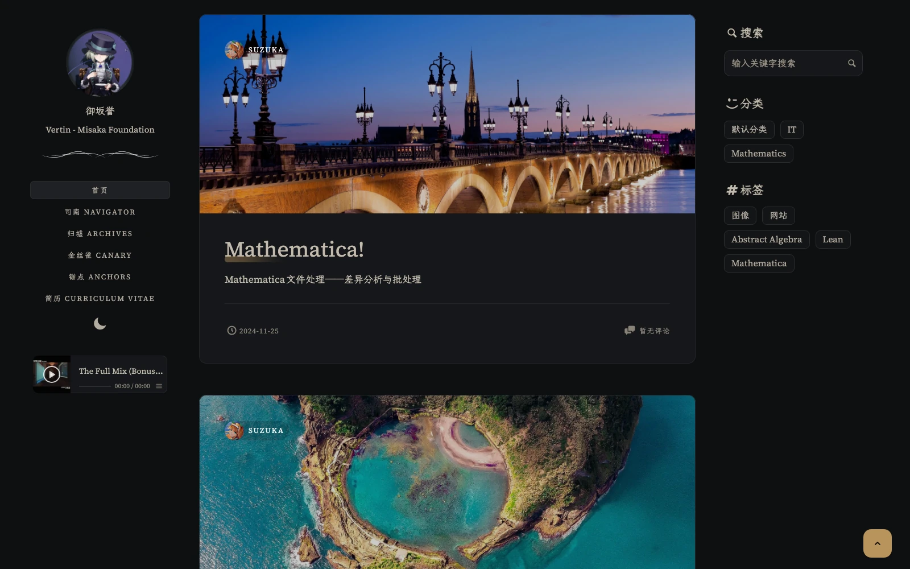

# vertin.me · Yosemite

Vertin 个人博客的 Astro 静态站点实现。以 Markdown 管理文章和独立页面，保留简洁的阅读布局，并围绕页面切换、目录、主题与长文阅读持续调整。

本项目以 [MoXiify](https://github.com/MoXiaoXi233) 的 [PureSuck-theme](https://github.com/MoXiaoXi233/PureSuck-theme) 为基础，借助 Codex 迁移到 Astro，沿用了原主题的视觉设计与短代码写法。感谢原作者的设计和开源贡献。

这是为个人站点维护的仓库，配置、内容和资源均按本站需要组织。如果你希望使用原版 Typecho 主题，请前往 [PureSuck-theme](https://github.com/MoXiaoXi233/PureSuck-theme)。



## 功能

- **内容与导航**：Markdown 文章、独立页面、分页、分类、标签和归档；独立页面自动合并到导航。
- **阅读体验**：文章目录、阅读时间、代码高亮、KaTeX 数学公式、图注与图片缩放。
- **主题与动效**：浅色、深色及跟随系统模式；页面切换、封面衔接和局部控件动效，支持减少动态效果设置。
- **正文组件**：提示框、彩色信息窗、友链卡片、折叠面板、Tabs、时间线、B 站视频和图片网格。
- **搜索与互动**：Pagefind 静态全文搜索、Twikoo 评论、跨页面保留播放状态的 APlayer 音乐播放器。
- **静态构建**：Astro 7 与 Vite 8；公式、短代码和图片元数据在构建时处理，搜索、播放器与评论按需加载。

## 快速开始

推荐使用 **Node.js 24**，与 CI 保持一致。项目声明的最低版本为 Node.js 22.23.4，使用 npm 管理依赖。

```bash
git clone https://github.com/Yu-Misaka/vertin.me.yosemite.git
cd vertin.me.yosemite/site
npm ci
npm run dev
```

开发服务器默认地址为 <http://localhost:4321/>。Astro 项目位于 `site/`，下文所有 npm 命令都在该目录执行。

| 命令 | 用途 |
| --- | --- |
| `npm run dev` | 启动开发服务器 |
| `npm run check` | 生成 Astro 类型并运行 TypeScript 检查 |
| `npm test` | 运行现有回归测试 |
| `npm run build` | 构建静态站点，并自动生成 Pagefind 搜索索引 |
| `npm run verify:build` | 检查已生成的页面与资源，需要先完成构建 |
| `npm run preview` | 本地预览生产构建 |

完整搜索体验需要生产构建。开发模式下出现“搜索索引尚未生成，请先运行 build”时，运行 `npm run build`，再通过 `npm run preview` 检查搜索。

## 项目结构

```text
.
├── .github/workflows/ci.yml   # 类型检查、回归测试和构建验证
├── docs/motion-design.md     # 动效设计与维护约束
├── LICENSE
└── site/
    ├── astro.config.mjs      # 静态输出与 Markdown 处理链
    ├── package.json
    ├── public/               # 图片、字体、音频等静态资源
    ├── scripts/verify-build.mjs
    ├── src/
    │   ├── config/           # 站点配置与主题配色
    │   ├── content/          # posts 文章与 pages 独立页面
    │   ├── content.config.ts # 内容集合与字段校验
    │   ├── components/       # 导航、侧栏、评论等组件
    │   ├── layouts/          # 页面共用布局
    │   ├── pages/            # Astro 页面与路由
    │   ├── remark/           # Markdown 语法处理
    │   ├── rehype/           # 短代码、公式和正文 HTML 处理
    │   ├── integrations/     # 字体构建插件
    │   ├── scripts/          # 客户端交互与页面生命周期
    │   ├── styles/           # 主题、组件和动效样式
    │   └── utils/            # 摘要、目录与图片工具
    └── test/                 # 回归测试
```

## 站点配置

主要配置集中在 [site/src/config/site.ts](site/src/config/site.ts)，主题色定义在 [site/src/config/theme.ts](site/src/config/theme.ts)。

| 配置 | 用途 |
| --- | --- |
| `title`、`titleIndex`、`description` | 站点标题、左侧栏标题与简介 |
| `author`、`logoIndex`、`logoIndexUrl` | 作者信息、头像与头像链接 |
| `navItems` | 自定义导航链接及排序 |
| `postsPerPage` | 列表每页文章数 |
| `archivesCover` | 归档页封面 |
| `show` | 搜索、目录、标签、分类、卡片分类、字数与版权信息开关 |
| `themeColor` | 主题配色，当前使用 `brass` |
| `postTitleAfter` | 标题装饰：`off`、`boldLine` 或 `wavyLine` |
| `ccLicense` | 文章版权卡片中的 Creative Commons 许可 |
| `comments` | Twikoo 评论服务配置 |
| `aplayer` | 播放器开关、样式与播放列表 |
| `footerInfo` | 页脚文案，支持 HTML |
| `leftSideCustomCode`、`footerScript` | 左侧栏自定义 HTML 与页脚脚本注入 |

复用站点时，先替换作者信息、导航、图片、评论地址和播放列表。静态资源放在 `site/public/`，引用路径从站点根目录开始，例如 `site/public/images/avatar.webp` 对应 `/images/avatar.webp`。

## 写作

内容集合及字段校验以 [site/src/content.config.ts](site/src/content.config.ts) 为准。

### 文章

在 `site/src/content/posts/` 下新建 Markdown 文件。例如 `hello-world.md` 会生成 `/posts/hello-world/`。

```markdown
---
title: "Hello Yosemite"
description: "一篇关于这个站点的文章。"
date: 2026-10-30
tags: ["Astro", "网站"]
category: "技术"
cover: "/images/avatar.webp"
draft: false
---

## 开始写作

这里是正文。
```

| 字段 | 类型 | 必填 | 说明 |
| --- | --- | --- | --- |
| `title` | `string` | 是 | 文章标题 |
| `date` | `date` | 是 | 发布时间，按示例使用 YAML 日期格式 |
| `description` | `string` | 否 | 摘要；未填写时从正文截取 |
| `updated` | `date` | 否 | 更新时间；当前页面未单独展示 |
| `tags` | `string[]` | 否 | 标签，默认 `[]` |
| `category` | `string` | 否 | 分类 |
| `cover` | `string` | 否 | 封面图片，支持站内路径或外链 |
| `draft` | `boolean` | 否 | 默认 `false`；设为 `true` 的文章不生成页面，也不进入文章列表 |

### 独立页面

在 `site/src/content/pages/` 下新建 Markdown 文件。例如 `about.md` 会生成 `/about/`。

```markdown
---
title: "关于"
description: "关于这个站点。"
order: 1
---

这里是页面正文。
```

| 字段 | 类型 | 必填 | 说明 |
| --- | --- | --- | --- |
| `title` | `string` | 是 | 页面标题，也用作导航名称 |
| `description` | `string` | 否 | 页面描述 |
| `date` | `date` | 否 | 页面日期 |
| `cover` | `string` | 否 | 封面图片 |
| `order` | `number` | 否 | 导航排序，越小越靠前；未填写时按 `999` 排序 |

所有独立页面都会参与导航生成，与 `navItems` 合并后按 `order` 排序；路径完全相同的链接优先使用 `navItems` 中的配置。实现见 [Header.astro](site/src/components/Header.astro)。

### Markdown 与公式

正文支持代码高亮、表格、任务列表、脚注与删除线。公式由 KaTeX 在构建时渲染：

```markdown
行内公式：$E = mc^2$

$$
\int_0^1 x^2\,dx = \frac{1}{3}
$$
```

正文图片使用原生懒加载，并默认支持点击放大；图片的 `alt` 文本会作为图注。需要关闭放大或图注时，可使用 HTML 图片标签并添加 `no-zoom` 或 `no-figcaption` 类。

### 主题短代码

迁移实现保留了以下 PureSuck 短代码，在构建时编译为 HTML。代码块和行内代码中的示例会保持原样。

| 组件 | 写法 |
| --- | --- |
| 提示框 | `[alert type="red"]内容[/alert]`，支持 `green`、`blue`、`yellow`、`red` |
| 彩色信息窗 | `[window type="blue" title="标题"]内容[/window]`，另支持 `green`、`yellow`、`red`、`pink` |
| 友链卡片 | `[friend-card name="好友" ico="/images/avatar.webp" url="https://example.com"]描述[/friend-card]` |
| 折叠面板 | `[collapsible-panel title="展开阅读"]内容[/collapsible-panel]` |
| 时间线 | `[timeline][timeline-event date="2026-10-30" title="标题"]内容[/timeline-event][/timeline]` |
| Tabs | `[tabs][tab title="标签一"]内容一[/tab][tab title="标签二"]内容二[/tab][/tabs]` |
| B 站视频 | `[bilibili-card bvid="BV1KJ411C7SB"]` |
| 图片网格 | 使用 `[PicGrid]` 与 `[/PicGrid]` 包裹多张 Markdown 图片 |

Tabs、时间线和图片网格可分多行编写；信息窗中需要显式换行时可使用 `<br>`。编译逻辑见 [shortcodes.mjs](site/src/rehype/shortcodes.mjs)。

## 评论与音乐

**Twikoo**：在 `site.ts` 中设置 `comments.provider = "twikoo"`，并将 `comments.envId` 替换为自己的服务地址或环境 ID。评论服务需要单独部署；地址为空时，页面显示“评论区已关闭”。评论组件接近视口时才加载。

**APlayer**：通过 `aplayer.enabled` 开关播放器，在 `aplayer.audio` 中设置曲名、音频地址与封面。播放器在页面切换间保留状态，音频在点击播放后下载。本地音频和封面可放在 `site/public/playlist/`。

## 构建与部署

提交前可运行与 CI 对应的检查：

```bash
npm run check
npm test
npm run build
npm run verify:build
```

`verify:build` 检查生成页面的重复 ID、目录目标、公式错误、站内图片尺寸、脚本资源及 Pagefind 索引。CI 使用 Node.js 24，流程见 [.github/workflows/ci.yml](.github/workflows/ci.yml)。

站点使用 Astro 静态输出，可部署到 Vercel 或其他静态托管服务。以下路径以仓库根目录为起点：

| 部署项 | 设置 |
| --- | --- |
| 项目根目录 | `site` |
| 安装命令 | `npm ci` |
| 构建命令 | `npm run build` |
| 输出目录 | `dist`，相对于 `site/` |
| Node.js 版本 | `24` |

构建产物位于 `site/dist/`。部署时上传整个目录，包括 `pagefind/` 搜索索引和 `404.html`。当前布局也集成了 Vercel Analytics 与 Speed Insights，相关入口见 [BaseLayout.astro](site/src/layouts/BaseLayout.astro)。

## 维护说明

客户端交互由 [app.js](site/src/scripts/app.js) 统一管理页面生命周期，Astro ClientRouter 负责导航与滚动恢复。修改交互时应释放页面离开后的监听器、观察器和异步工作；正文短代码、公式与图片处理集中在构建阶段。

动效时长、缓动与位移统一定义在 [motion.css](site/src/styles/motion.css)。修改导航或动效前，可参阅 [动效设计说明](docs/motion-design.md) 中的约束和验收场景。修改 Markdown 处理插件后，需要重启开发服务器使其生效。

## 致谢与许可

- [PureSuck-theme](https://github.com/MoXiaoXi233/PureSuck-theme) · [MoXiify](https://github.com/MoXiaoXi233)：本站主题的来源，提供了视觉设计、阅读布局与短代码组件的基础。
- [Astro](https://astro.build/) 与 [Vite](https://vite.dev/)：静态构建与前端工具链。
- [Pagefind](https://pagefind.app/) 与 [KaTeX](https://katex.org/)：全文搜索与数学公式渲染。
- [Twikoo](https://twikoo.js.org/)、[APlayer](https://aplayer.js.org/) 与 [medium-zoom](https://github.com/francoischalifour/medium-zoom)：评论、音乐播放与图片缩放。

仓库使用 [MIT License](LICENSE)，保留了原作者 `Copyright © 2024 MoXiify` 的版权声明。复用或分发代码时，请保留该声明与许可文本。文章页面当前标注的 CC BY-NC-SA 4.0 由 `site.ccLicense` 配置；图片、字体和音乐等资源按各自的许可与来源说明使用。
